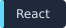

 

 

## À propos

Développeur web, je conçois des applications **modernes**, **pratiques** et **agréables à utiliser**.

J'apprends en construisant des projets, en résolvant des problèmes concrets et en testant de nouvelles technologies. Je donne la priorité aux **fondamentaux** avant de passer à des concepts plus avancés.

Centres d'intérêt : développement web, développement logiciel, design UI/UX et outils de développement modernes.

 

## Technologies

| Catégorie | Technologies |
|:--|:--|
| **Langages** |  |
| **Frontend** |  |
| **Backend** |  |
| **Bases de données** |  |
| **DevOps & Systèmes** |  |
| **API & Tests** |  |
| **Gestion de projet** |    |
| **UI / UX** |  |
| **Outils** |   |
| **Déploiement** |  |

 

## Compétences UI / UX

 

## En cours d'apprentissage

 

## Approche de développement

| Construire | Résoudre | Expérimenter |
|:--|:--|:--|
| J'apprends en réalisant de vrais projets. | Je traite les problèmes concrets étape par étape. | Je teste de nouvelles technologies pour progresser. |

 

## Contact

 

 

